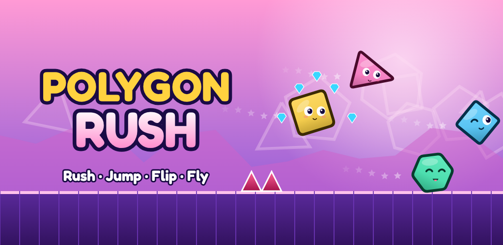
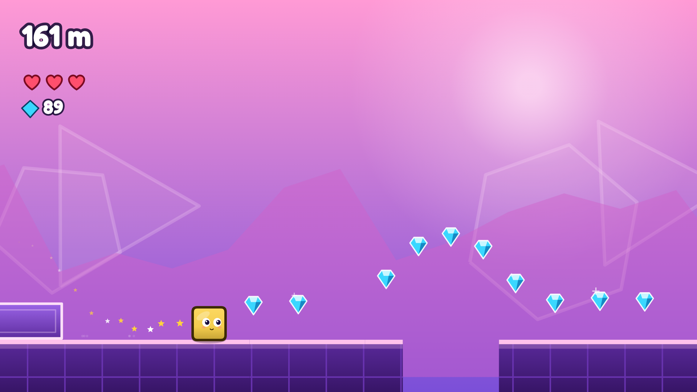
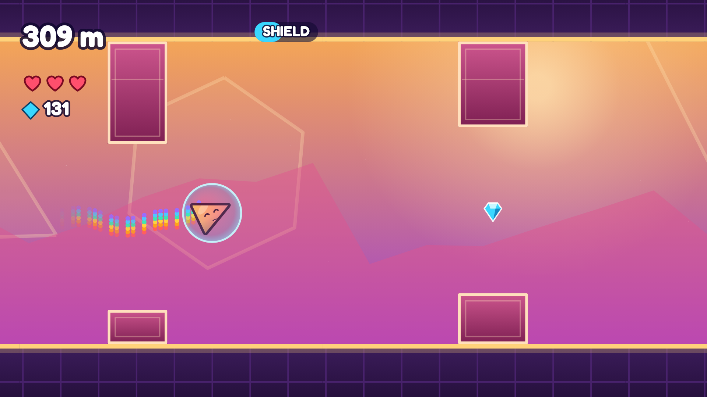
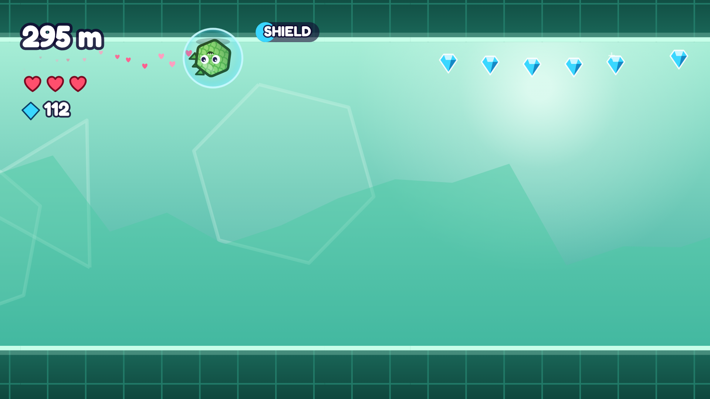
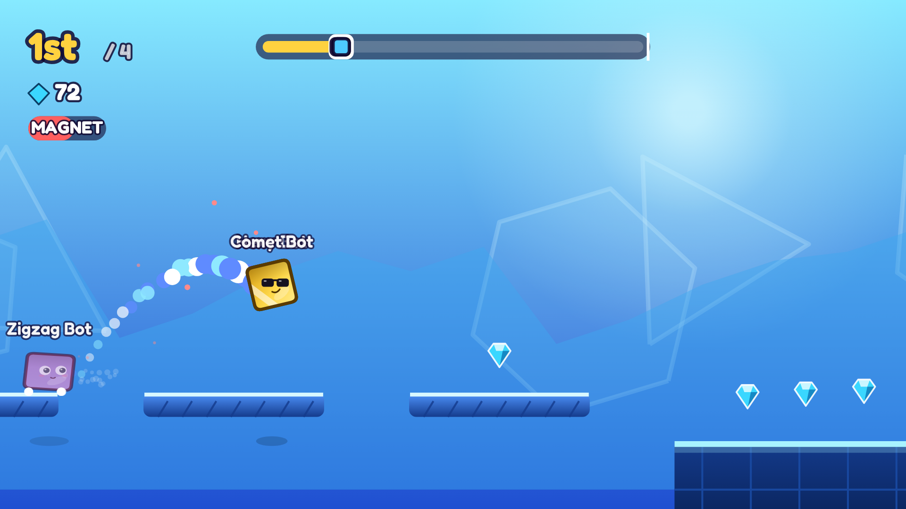

# Polygon Rush



**An endless, shape-shifting runner for every age, by [Soft-Game Brothers](https://softgamebros.com).** Rush through infinite polygon worlds as a **Jumper** (square), **Glider** (triangle), **Roller** (hexagon) and **Hopper** (diamond). Play solo, race CPU rivals, duel a friend on the same phone, race up to three friends online with a room code, or **build your own levels**, alone or together.

Think *Geometry Dash* rhythm and precision meets *Fun Run* racing chaos, wrapped in a bright, kid-friendly look with an original soundtrack.

| | |
| --- | --- |
|  |  |
|  |  |

## Features

* **Four shapes, one button.** Tap to jump, hold to glide, tap to flip gravity, tap to hop. Portals switch shapes mid-run.
* **Endless & always fair.** A seeded procedural generator builds infinite levels that speed up as you go, and an automated bot test proves every level is beatable.
* **Race** 3 CPU rivals with mystery boxes (boost, shield, snowball, magnet), leagues from Bronze to *Polygon Legend*, and trophies that never go down.
* **2-Player Duel** on one device (split screen), plus **Play with Friends** online via private 4-character rooms (peer-to-peer).
* **Create mode:** a touch level editor (blocks, ledges, spikes, saws, gems, pads, orbs, power-ups, shape portals, pits) with undo/redo, test-from-here, and beat-it-to-share verification. Levels travel as compact `PR1-…` codes. Four built-in Featured levels to play or remix.
* **Build Together:** up to 4 players edit one level live (host-ordered edits with instant local preview, coloured cursors, lock and remove), then race it.
* **Chat that fits the age:** Quick Chat only (preset phrases & emotes, with extra phrase packs in the shop). There is no typed chat. Friends by Name#number, Community levels, public build rooms, public race rooms and **Quick Match** for 13+ (under-13s keep private code rooms) use the [community server](server/README.md).
* **Six worlds** with their own palettes and parallax scenery, and a soundtrack of original synthesised songs plus licensed tracks (credits in `public/music/CREDITS.txt`). Endless levels are built on the beat of each level's song.
* **Level select:** start Endless from any 500 m level you've reached.
* **Game Modes hub:** Endless, a **Daily Run** (same course for everyone, daily reward), **One Heart**, **Gem Rush** (60 s), Race, Online, Duel and Player Levels.
* **Seasonal events:** Spooky Season (Oct 1 – Nov 7) brings Halloween skins and trails, a free Wicked Witch skin, a haunted menu and Daily Run, and the Haunted Hop theme.
* **Easy / Normal / Extreme**, chosen on first launch: separate speed and pattern curves and best scores; Endless keeps getting more chaotic the further you go.
* **Player profiles:** badges, titles, banners and stats to show off in rooms. Only game facts are shared, never free text.
* **23 skins** (patterns and silly faces: shades, kitty, dino, robot, galaxy, gold…), **11 trails**, missions, daily gifts, levels, Kid Mode.
* **Kid-safe by design:** neutral age screen, G-rated child-directed ads for under-13s, a grown-up check before purchases, parental controls (online, Quick Chat, public rooms, Free Chat, purchases), generated names only, no analytics. Under-13s never get typed chat or public rooms. See [docs/SAFETY.md](docs/SAFETY.md).
* **Monetisation:** optional rewarded videos, capped between-run interstitials, a menu banner, plus No Ads / Starter Pack / Legend Pack / gem packs (Google Play Billing). See [docs/MONETIZATION.md](docs/MONETIZATION.md).

## Tech

TypeScript + Canvas 2D + Web Audio, bundled by Vite and packaged for Android with **Capacitor 8** (target SDK 36, landscape, immersive). There are no game-engine dependencies: physics, level generation, CPU rivals, rendering and music are all in `src/`.

```
src/
  game/      physics, level generator, player levels, CPU rivals, sessions, controller
  editor/    level editor: document & undo, co-op sync, canvas scene, tools
  render/    renderer, characters & skins, effects, worlds, HUD
  core/      audio engine + songs, haptics, rng, platform
  services/  AdMob, Play Billing, PeerJS rooms, chat, accounts, public rooms
  shared/    chat filter shared with the server
  meta/      catalog, economy, missions, featured levels, quick chat, community rules
  ui/        screens, components, navigation
server/      optional community server (signalling, public rooms, Free Chat, moderation)
tests/       physics, sessions, solvability, levels, editor sync, chat filter, soundtrack & playlists, profiles
tools/ scripts/  art generator (icons, splash, store graphics), keystore helper
```

Design details: [docs/GAME_DESIGN.md](docs/GAME_DESIGN.md).

## Develop

```bash
npm ci
npm run dev          # http://localhost:5173 (ads & purchases are simulated in the browser)
npm test             # unit tests incl. level solvability
npm run typecheck

# optional community server (public rooms + Free Chat)
cd server && npm ci && npm run dev     # then VITE_SERVER_URL=http://localhost:8080 npm run dev
```

Android (JDK 21 + Android SDK 36):

```bash
npm run android:debug     # android/app/build/outputs/apk/debug/app-debug.apk
npm run android:release   # release APK + AAB (see docs/RELEASE.md for signing)
```

## Build & release on GitHub

* **Every push** runs `.github/workflows/android-ci.yml`: typecheck → tests → web build → debug APK, uploaded as the `polygon-rush-debug-apk` artifact; plus the community server's typecheck, integration tests and Docker image build.
* **Releases** run `.github/workflows/release.yml` **only when you authorise them** (Actions → *Release* → *Run workflow*, or push a `v1.0.0` tag). It builds a signed APK + AAB and publishes a GitHub Release.

Step-by-step (signing key, secrets, AdMob ids, Play Console products, privacy page): **[docs/RELEASE.md](docs/RELEASE.md)**. Store listing copy and graphics: [`store/`](store).

## License

Proprietary: © 2026 Soft-Game Brothers, all rights reserved. See [LICENSE](LICENSE). The bundled Fredoka font is under the SIL Open Font License 1.1, and licensed music is credited in `public/music/CREDITS.txt`.

## About

Polygon Rush is developed and published by **Soft-Game Brothers**.

* Help with the game: polygonrush@softgamebros.com
* Privacy and data requests: privacy@softgamebros.com
* Parents and safety reports: safety@softgamebros.com
* Website and privacy policy: https://softgamebros.com/polygon-rush/

Copyright © 2026 Soft-Game Brothers. All rights reserved. See [LICENSE](LICENSE).
